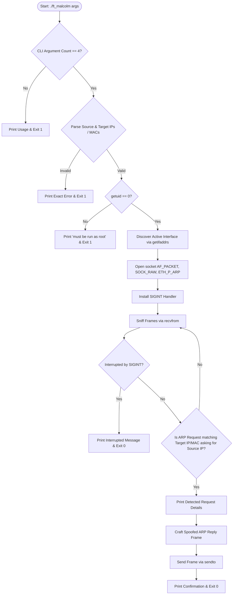

# ft_malcolm

> **An introduction to Man-in-the-Middle (MITM) attacks through Address Resolution Protocol (ARP) spoofing and cache poisoning.**  
> *42 Network Security Branch — Version 2.2*

---

## Table of Contents
1. [Overview](#overview)
2. [Theoretical Background](#theoretical-background)
   - [The OSI Model & Address Resolution](#the-osi-model--address-resolution)
   - [The ARP Protocol (RFC 826 & RFC 7042)](#the-arp-protocol-rfc-826--rfc-7042)
   - [The Vulnerability: Why ARP Can Be Spoofed](#the-vulnerability-why-arp-can-be-spoofed)
   - [How Cache Poisoning Leads to Man-in-the-Middle](#how-cache-poisoning-leads-to-man-in-the-middle)
3. [Project Specifications & 42 Rules](#project-specifications--42-rules)
   - [Allowed Functions & System Constraints](#allowed-functions--system-constraints)
   - [The "No bind()" Design](#the-no-bind-design)
   - [The Single Global Variable Rule](#the-single-global-variable-rule)
4. [Internal Architecture & Implementation](#internal-architecture--implementation)
   - [Frame & Packet Structure (Byte Layout)](#frame--packet-structure-byte-layout)
   - [Module Breakdown](#module-breakdown)
   - [Program Flowchart](#program-flowchart)
5. [Compilation & Installation](#compilation--installation)
6. [Usage & CLI Options](#usage--cli-options)
   - [Mandatory Syntax](#mandatory-syntax)
   - [Bonus Syntax](#bonus-syntax)
   - [Example Execution](#example-execution)
   - [Error Handling](#error-handling)
7. [Testing Lab: Reproducing with Network Namespaces](#testing-lab-reproducing-with-network-namespaces)
   - [Setting up Virtual Nodes (Target & Attacker)](#setting-up-virtual-nodes-target--attacker)
   - [Executing the Attack](#executing-the-attack)
   - [Verifying the Target's ARP Cache](#verifying-the-targets-arp-cache)
   - [Tearing Down the Lab](#tearing-down-the-lab)
8. [Security & Ethics Disclaimer](#security--ethics-disclaimer)

---

## Overview

`ft_malcolm` is a network security tool developed in C for Linux environments. Its purpose is to demonstrate the mechanics of Layer 2 Address Resolution Protocol (ARP) spoofing, commonly used as the foundation for Man-in-the-Middle (MITM) attacks in local area networks (LANs).

The tool sits passively on an active network interface, listening for an ARP broadcast request transmitted by a specified **Target** seeking the physical address of a specified **Source IP**. The instant the target's request is intercepted, `ft_malcolm` crafts and transmits a forged, unicast ARP reply directly to the target. This reply associates the Source IP with an attacker-controlled **Source MAC address**, corrupting the target's dynamic ARP table before any legitimate host can respond.

---

## Theoretical Background

### The OSI Model & Address Resolution

In the standard 7-layer Open Systems Interconnection (OSI) model:
- **Layer 3 (Network Layer)** uses logical addresses (e.g., IPv4 addresses such as `192.168.1.10`) to route packets across disparate networks.
- **Layer 2 (Data Link Layer)** uses physical hardware addresses (Media Access Control / MAC addresses such as `aa:bb:cc:dd:ee:ff`) to frame and deliver data across a shared physical medium (e.g., an Ethernet switch or Wi-Fi).

```
+-------------------------------------------------------------+
| Layer 3: Network Layer        IPv4 Addresses (e.g. 10.0.0.1)|
+-------------------------------------------------------------+
                               |
               [ ARP: Address Resolution Protocol ]
                               |
                               v
+-------------------------------------------------------------+
| Layer 2: Data Link Layer      MAC Addresses  (e.g. 02:42:...)|
+-------------------------------------------------------------+
```

Because network interfaces cannot deliver raw Ethernet frames using IP addresses alone, hosts require a mapping mechanism between Layer 3 and Layer 2. **ARP (Address Resolution Protocol)** fulfills this role in IPv4 networks.

---

### The ARP Protocol (RFC 826 & RFC 7042)

Defined originally in **RFC 826** and updated for IANA number assignments in **RFC 7042**, the standard resolution workflow proceeds as follows:

1. **ARP Request (Broadcast)**:
   - When Host $A$ (`10.0.0.2`, MAC `02:00:00:00:00:02`) wants to communicate with Host $B$ (`10.0.0.1`), Host $A$ checks its local ARP cache.
   - If no entry is found, Host $A$ broadcasts an Ethernet frame to the special Layer 2 broadcast destination: `ff:ff:ff:ff:ff:ff`.
   - The message asks: *"Who has IP 10.0.0.1? Tell 10.0.0.2 at 02:00:00:00:00:02"*.

2. **ARP Reply (Unicast)**:
   - Every station on the broadcast domain receives the request, but only the host configured with `10.0.0.1` should process it.
   - Host $B$ records Host $A$'s mapping into its own ARP table and sends an ARP reply directed to Host $A$'s unicast MAC address:
     *"10.0.0.1 is at 02:00:00:00:00:01"*.
   - Host $A$ receives the reply and inserts the mapping into its dynamic ARP cache.

```
       Host A (Target)                             Host B (Gateway / Source)
      10.0.0.2 / MAC_A                                 10.0.0.1 / MAC_B
             |                                                 |
             | ----- 1. ARP Request (Broadcast to FF:..) ----> |
             |       "Who has 10.0.0.1? Tell 10.0.0.2"         |
             |                                                 |
             | <---- 2. Legitimate ARP Reply (Unicast) ------- |
             |       "10.0.0.1 is at MAC_B"                    |
             v                                                 v
   [ARP: 10.0.0.1 -> MAC_B]
```

---

### The Vulnerability: Why ARP Can Be Spoofed

When ARP was conceived in 1982, local networks were assumed to consist entirely of trusted hosts. Consequently:
1. **Stateless / No Authentication**: There are no digital signatures, sequence numbers, or cryptographic tokens in an ARP packet. Any host can generate an ARP packet with arbitrary header fields.
2. **Dynamic Cache Updates**: Operating systems update their internal ARP table whenever they receive an ARP reply matching a requested IP, even if the reply arrived unsolicited or preceded the genuine host's reply.
3. **First-Come, First-Served**: If an attacker replies before the genuine host (or floods replies), the victim's operating system commits the attacker's hardware address to memory.

---

### How Cache Poisoning Leads to Man-in-the-Middle

In a classic MITM scenario:
1. The attacker poisons the **Target (Victim)** by claiming the IP address of the **Default Gateway** resolves to the **Attacker's MAC**.
2. The attacker poisons the **Gateway** by claiming the Victim's IP resolves to the **Attacker's MAC**.
3. All subsequent traffic between Victim and the Internet passes through the attacker's machine, enabling traffic inspection, credential harvesting, or tampering.

`ft_malcolm` demonstrates the primary building block of this vector: surgically targeting a single victim host the instant it emits an ARP discovery request.

```
+------------------+                      +------------------+
|  Target (Victim) |                      |    ft_malcolm    |
|  10.0.0.2        |                      |    (Attacker)    |
+--------+---------+                      +--------+---------+
         |                                         |
         |  1. Target Broadcasts ARP Request       |
         |     "Who has 10.0.0.1? Tell 10.0.0.2"   |
         |---------------------------------------->| (Intercepted via AF_PACKET)
         |                                         |
         |  2. Spoofed ARP Reply Transmitted       |
         |     "10.0.0.1 is at AA:BB:CC:DD:EE:FF"  |
         |<----------------------------------------| (Delivered via sendto)
         |                                         |
         v                                         v
  [ARP Cache Poisoned]                       [Clean Exit]
```

---

## Project Specifications & 42 Rules

### Allowed Functions & System Constraints

The 42 subject defines a strict whitelist of permitted system calls and libc functions:

| Category | Permitted Functions | Usage in `ft_malcolm` |
|---|---|---|
| **Networking & Sockets** | `sendto`, `recvfrom`, `socket`, `setsockopt` | Raw socket creation (`AF_PACKET`), receive timeout configuration, packet transmission and sniffing. |
| **Address Conversion** | `inet_pton`, `inet_ntop`, `inet_addr`, `htons`, `ntohs` | String-to-binary IP parsing, binary-to-string formatting, network byte order conversions. |
| **Interface & Resolution**| `if_nametoindex`, `getifaddrs`, `freeifaddrs`, `getaddrinfo`, `freeaddrinfo`, `gethostbyname` | Locating active, broadcast-capable interfaces and resolving hostnames in bonus mode. |
| **Process & Signals** | `getuid`, `close`, `sleep`, `sigaction`, `signal` | Verifying root privileges, closing socket descriptors, gracefully intercepting `SIGINT` (Ctrl+C). |
| **Diagnostic & Errors** | `strerror`, `gai_strerror`, `printf` (family) | Human-readable system call error reporting and standardized console output. |
| **Custom Library** | `libft` | String manipulation, memory setting (`ft_bzero`, `ft_memcpy`), character validation. |

---

### The "No bind()" Design

In standard network socket programming, `bind()` is commonly used to bind a socket to a local interface or port. However, **`bind` is NOT included in the allowed functions whitelist** of the 42 subject.

`ft_malcolm` overcomes this constraint cleanly using native Linux socket semantics:
1. `socket(AF_PACKET, SOCK_RAW, htons(ETH_P_ARP))` registers the process directly with the kernel's Layer 2 packet handler. The socket intercepts ARP packets across interfaces without needing a socket binding.
2. For transmission, `sendto()` accepts a pointer to a `struct sockaddr_ll` (defined in `<linux/if_packet.h>`), where the target interface index is explicitly supplied in `sll_ifindex`:
   ```c
   struct sockaddr_ll sll;
   ft_bzero(&sll, sizeof(sll));
   sll.sll_family = AF_PACKET;
   sll.sll_ifindex = ctx->ifindex; // Retrieved via if_nametoindex()
   sll.sll_halen = ETH_ALEN;
   ft_memcpy(sll.sll_addr, ctx->tgt_mac, ETH_ALEN);

   sendto(ctx->sockfd, &packet, sizeof(packet), 0,
          (struct sockaddr *)&sll, sizeof(sll));
   ```
This design fully complies with 42 grading criteria while remaining 100% standards-compliant on Linux.

---

### The Single Global Variable Rule

The subject specifies: *"You are allowed to use one global variable within your project."*

`ft_malcolm` declares exactly one global variable:
```c
volatile sig_atomic_t g_running = 1;
```
Located in [`src/signals.c`](file:///mnt/projects/sne/Gohar/16.PROJECT_42/ft_malcolm/src/signals.c), it allows asynchronous signal handlers (`SIGINT`, `SIGTERM`) to notify the blocking receive loop to release socket descriptors and terminate cleanly.

---

## Internal Architecture & Implementation

### Frame & Packet Structure (Byte Layout)

An ARP Ethernet frame consists of a 14-byte **Ethernet Header** followed immediately by a 28-byte **ARP Payload**, totaling 42 bytes:

```
 0                   1                   2                   3
 0 1 2 3 4 5 6 7 8 9 0 1 2 3 4 5 6 7 8 9 0 1 2 3 4 5 6 7 8 9 0 1
+-+-+-+-+-+-+-+-+-+-+-+-+-+-+-+-+-+-+-+-+-+-+-+-+-+-+-+-+-+-+-+-+
|                  Destination MAC Address (Octets 0-3)         |
+-+-+-+-+-+-+-+-+-+-+-+-+-+-+-+-+-+-+-+-+-+-+-+-+-+-+-+-+-+-+-+-+
|  Dest MAC (Octets 4-5)        |  Source MAC Address (Octets 0-1)
+-+-+-+-+-+-+-+-+-+-+-+-+-+-+-+-+-+-+-+-+-+-+-+-+-+-+-+-+-+-+-+-+
|                  Source MAC Address (Octets 2-5)              |
+-+-+-+-+-+-+-+-+-+-+-+-+-+-+-+-+-+-+-+-+-+-+-+-+-+-+-+-+-+-+-+-+
|       EtherType (0x0806)      |    Hardware Type (0x0001)     |
+-+-+-+-+-+-+-+-+-+-+-+-+-+-+-+-+-+-+-+-+-+-+-+-+-+-+-+-+-+-+-+-+
|      Protocol Type (0x0800)   |  HW Size (6)  | Proto Size (4)|
+-+-+-+-+-+-+-+-+-+-+-+-+-+-+-+-+-+-+-+-+-+-+-+-+-+-+-+-+-+-+-+-+
|         Opcode (0x0002)       |  Sender MAC (Octets 0-1)      |
+-+-+-+-+-+-+-+-+-+-+-+-+-+-+-+-+-+-+-+-+-+-+-+-+-+-+-+-+-+-+-+-+
|                  Sender MAC Address (Octets 2-5)              |
+-+-+-+-+-+-+-+-+-+-+-+-+-+-+-+-+-+-+-+-+-+-+-+-+-+-+-+-+-+-+-+-+
|                  Sender IPv4 Address (4 Octets)               |
+-+-+-+-+-+-+-+-+-+-+-+-+-+-+-+-+-+-+-+-+-+-+-+-+-+-+-+-+-+-+-+-+
|                  Target MAC Address (Octets 0-3)              |
+-+-+-+-+-+-+-+-+-+-+-+-+-+-+-+-+-+-+-+-+-+-+-+-+-+-+-+-+-+-+-+-+
|  Target MAC (Octets 4-5)      |  Target IPv4 Address (Octets 0-1)
+-+-+-+-+-+-+-+-+-+-+-+-+-+-+-+-+-+-+-+-+-+-+-+-+-+-+-+-+-+-+-+-+
|  Target IPv4 Address (Octets 2-3)                             |
+-+-+-+-+-+-+-+-+-+-+-+-+-+-+-+-+-+-+-+-+-+-+-+-+-+-+-+-+-+-+-+-+
```

In [`include/arp.h`](file:///mnt/projects/sne/Gohar/16.PROJECT_42/ft_malcolm/include/arp.h), packed structures ensure no compiler padding interferes with wire serialization:

```c
typedef struct s_eth_hdr {
    uint8_t  dest[6];
    uint8_t  src[6];
    uint16_t proto;
} __attribute__((packed)) t_eth_hdr;

typedef struct s_arp_hdr {
    uint16_t hrd;           // 1 for Ethernet
    uint16_t pro;           // 0x0800 for IPv4
    uint8_t  hln;           // 6 bytes MAC
    uint8_t  pln;           // 4 bytes IPv4
    uint16_t op;            // 1 = Request, 2 = Reply
    uint8_t  sha[6];        // Sender Hardware Address (Spoofed MAC)
    uint8_t  spa[4];        // Sender Protocol Address (Source IP)
    uint8_t  tha[6];        // Target Hardware Address (Target MAC)
    uint8_t  tpa[4];        // Target Protocol Address (Target IP)
} __attribute__((packed)) t_arp_hdr;
```

---

### Module Breakdown

- [`src/main.c`](file:///mnt/projects/sne/Gohar/16.PROJECT_42/ft_malcolm/src/main.c): Validates CLI inputs, checks `getuid() == 0`, coordinates initialization, launches the listener, and handles clean descriptor closure.
- [`src/parser.c`](file:///mnt/projects/sne/Gohar/16.PROJECT_42/ft_malcolm/src/parser.c): Strict parser for 6-byte hexadecimal MAC strings (`XX:XX:XX:XX:XX:XX`) and IPv4 addresses (`inet_pton`). Also handles bonus hostname resolution (`getaddrinfo`) and decimal IP notations.
- [`src/network.c`](file:///mnt/projects/sne/Gohar/16.PROJECT_42/ft_malcolm/src/network.c): Iterates through system interfaces using `getifaddrs`, checks flags (`IFF_UP`, `IFF_RUNNING`, `!IFF_LOOPBACK`, `!IFF_NOARP`), resolves subnet affinities against the target IP, prints the interface, and configures the raw socket with `SO_RCVTIMEO`.
- [`src/packet.c`](file:///mnt/projects/sne/Gohar/16.PROJECT_42/ft_malcolm/src/packet.c): Fills the Ethernet and ARP reply headers and issues `sendto()`. Provides packet dissection output when verbose mode is toggled.
- [`src/listener.c`](file:///mnt/projects/sne/Gohar/16.PROJECT_42/ft_malcolm/src/listener.c): Continuous `recvfrom()` loop. Inspects incoming frames against the strict matching filter:
  - Opcode == `ARPOP_REQUEST` (1)
  - Sender MAC == Target MAC
  - Sender IP == Target IP
  - Target IP == Source IP (the victim is actively seeking our spoofed IP)
- [`src/signals.c`](file:///mnt/projects/sne/Gohar/16.PROJECT_42/ft_malcolm/src/signals.c): Implements the POSIX `sigaction` signal handler for `SIGINT` (Ctrl+C).

---

### Program Flowchart



---

## Compilation & Installation

The project includes a robust Makefile that manages both `libft` and `ft_malcolm`:

```bash
# Compile standard mandatory binary
make

# Compile with bonus features (verbose mode, hostname resolution, decimal notation)
make bonus

# Clean object files
make clean

# Clean object files, binary, and compiled libft
make fclean

# Full re-compilation
make re
```

---

## Usage & CLI Options

### Mandatory Syntax

```bash
sudo ./ft_malcolm <source ip> <source mac address> <target ip> <target mac address>
```

Parameters must be provided in this exact order:
1. `source ip`: The IPv4 address being spoofed (e.g. gateway or another host).
2. `source mac address`: The spoofed MAC address you want the target to associate with the source IP.
3. `target ip`: The IPv4 address of the victim host.
4. `target mac address`: The actual hardware MAC address of the victim host.

---

### Bonus Syntax

When compiled with `make bonus`:
```bash
sudo ./ft_malcolm [-v] <source ip/host> <source mac> <target ip/host> <target mac>
```
- `-v`: Verbose mode. Prints full protocol header fields and hex dumps for intercepted and transmitted packets.
- Accepts hostnames (e.g., `localhost`, `gateway.local`) resolved via DNS.
- Accepts decimal/hex/octal notation for IPv4 addresses.

---

### Example Execution

```bash
$ sudo ./ft_malcolm 10.12.255.255 ff:bb:ff:ff:ee:ff 10.12.10.22 10:dd:b1:01:02:03
Found available interface: eth0
An ARP request has been broadcast.
mac address of request: 10:dd:b1:01:02:03
IP address of request: 10.12.10.22
Now sending an ARP reply to the target address with spoofed source, please wait...
Sent an ARP reply packet, you may now check the arp table on the target.
Exiting program...
```

---

### Error Handling

The program handles errors strictly according to the subject specifications:

- **Invalid IP Address:**
  ```bash
  $ sudo ./ft_malcolm 10.11.11.11 aa:bb:cc:dd:ee:ff 10.11.11.1111 aa:bb:cc:dd:ee:ff
  ft_malcolm: unknown host or invalid IP address: (10.11.11.1111).
  ```

- **Invalid MAC Address:**
  ```bash
  $ sudo ./ft_malcolm 10.11.11.11 aa:bb:cc:dd:ee:ff 10.11.11.11 aaa:bb:cc:dd:ee:ff
  ft_malcolm: invalid mac address: (aaa:bb:cc:dd:ee:ff)
  ```

- **Missing Superuser Privileges:**
  ```bash
  $ ./ft_malcolm 10.11.11.11 aa:bb:cc:dd:ee:ff 10.11.11.12 aa:bb:cc:dd:ee:ff
  ft_malcolm: must be run as root (uid 0)
  ```

---

## Testing Lab: Rootless Demonstration (`demo.sh`)

You do not need multiple computers, VMs, or `sudo` privileges to evaluate `ft_malcolm`. The included [`demo.sh`](demo.sh) leverages Linux **Unprivileged User Namespaces** (`unshare -r -n`) to construct a fully isolated virtual network sandbox in memory.

### Running the Demo (Zero Sudo Required)

```bash
./demo.sh
```

### What `demo.sh` Does:
1. **Host-Level Error Validation**: Tests argument handling, bad IP, and bad MAC rejection on the host.
2. **Rootless Namespace Transition**: Self-executes via `unshare -r -n` mapping your current user to virtual `uid 0` with full network capabilities in a private namespace.
3. **Virtual Ethernet Link**: Creates a `veth0` <-> `veth1` virtual pair with configured IP and MAC addresses.
4. **Execution & Interception**: Starts `ft_malcolm`, triggers an ARP resolution request, captures the packet, sends the spoofed ARP reply, and confirms table poisoning using `ip neigh show`.
5. **Zero Footprint**: Exiting the script automatically frees all virtual interfaces from kernel memory without touching your machine's physical network stack.

---

## Security & Ethics Disclaimer

> [!CAUTION]
> **Educational & Testing Notice**  
> `ft_malcolm` is developed exclusively for educational and academic evaluation purposes within the 42 curriculum. ARP spoofing on networks without explicit administrative authorization is illegal and constitutes a violation of cybersecurity regulations. Only test this software within isolated virtual machines, local Linux network namespaces, or private lab networks under your direct ownership.
